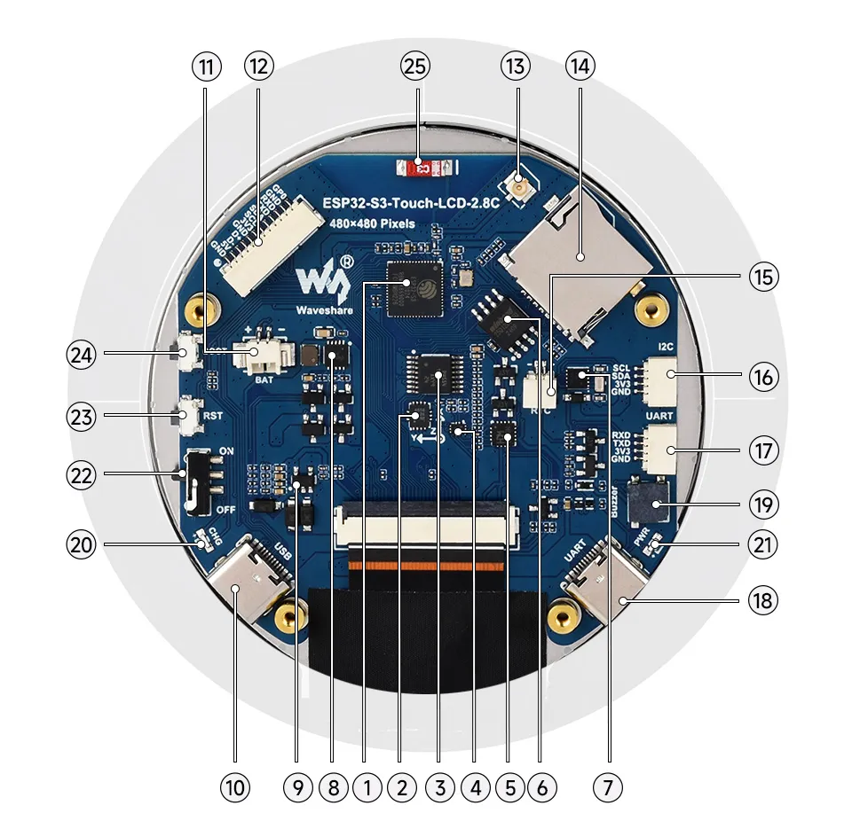
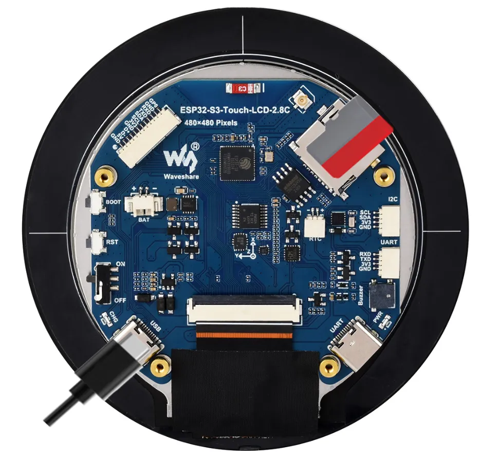
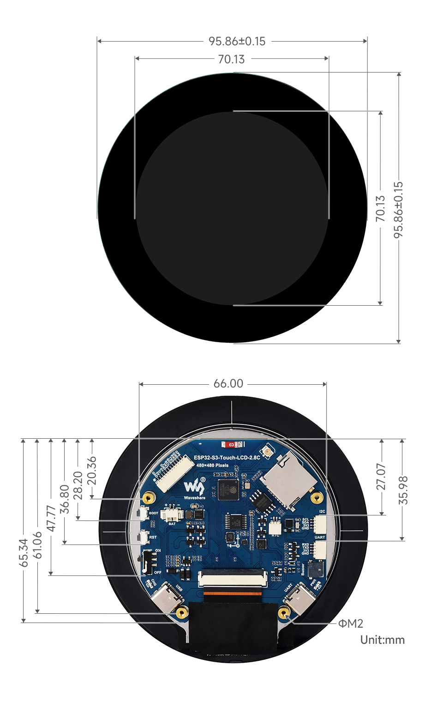

# 01 — Hardware Overview

Everything physically on the board, and what it means.

## Silicon

| # | Component | Detail |
| --- | --- | --- |
| 1 | **ESP32-S3R8** | Dual-core Xtensa LX7, up to 240 MHz. "R8" = 8 MB PSRAM. |
| 2 | **QMI8658** | 6-axis IMU — 3-axis gyroscope + 3-axis accelerometer. |
| 3 | **TCA9554PWR** | 8-bit I2C GPIO expander. **All 8 pins are used internally and none are broken out.** This is the source of most confusion with this board. |
| 4 | **FSUSB42UMX** | USB port selection switch. Disables the 4-pin UART header when the USB-to-UART Type-C is plugged in; enables it otherwise. |
| 5 | **CH343P** | USB-to-UART bridge with onboard auto-download circuit — flashing works without pressing BOOT in the normal case. |
| 6 | **Flash** | 16 MB |
| 7 | **PCF85063** | Real-time clock. Backup battery header provided. |
| 8 | — | Battery charging management IC |
| 9 | **ME6217C33M5G** | 3.3 V LDO, 800 mA max. |
| 19 | — | Buzzer (active, driven from expander pin 8) |
| — | **ST7701S** | LCD driver IC (on the flex, not the main PCB) |
| — | **GT911** | Capacitive touch controller (on the flex) |

## Memory budget

| Resource | Size | Notes |
| --- | --- | --- |
| SRAM | 512 KB | Internal, of which some is ROM-adjacent |
| ROM | 384 KB | |
| PSRAM | 8 MB | **Octal** SPI, 80 MHz — configured via `CONFIG_SPIRAM_MODE_OCT` |
| Flash | 16 MB | `CONFIG_ESPTOOLPY_FLASHSIZE_16MB` |

The PSRAM matters more than the raw number suggests: the LCD frame buffer lives
in PSRAM (`fb_in_psram = true`). The IDF example enables
`CONFIG_SPIRAM_FETCH_INSTRUCTIONS` and `CONFIG_SPIRAM_RODATA` specifically to
raise PCLK when the frame buffer is fetched by DMA. The board also sets
`CONFIG_ESP32S3_DATA_CACHE_LINE_64B` / `SIZE=64` — that is a DMA alignment
requirement, not a tuning knob. Do not casually change it.

> 480 × 480 × 2 bytes = **460,800 bytes per frame buffer** (450 KiB). A single
> double-buffered RGB565 display consumes ~0.9 MB of the 8 MB PSRAM, and PSRAM
> is slower than SRAM. A GPS data pipeline plus map tiles has to share what's
> left.

## Display

- 2.8 inch, **480 × 480**, capacitive touch
- Driven by **ST7701S** over an **RGB565 parallel** interface
- Backlight on GPIO6, PWM via LEDC channel 0
- Actual colour depth is **65K (RGB565)**, not the 262K the panel supports —
  an ESP-IDF architectural limit, confirmed in the vendor FAQ

## Touch

- **GT911** capacitive touch controller
- I2C at address `0x5D`, sharing the main bus
- Interrupt line on **GPIO16** — so touch can wake the CPU, which matters for a
  battery-powered device
- Reset is routed through the GPIO expander, not a direct GPIO

## Connectivity and expansion

| Interface | Pins | Notes |
| --- | --- | --- |
| **12-pin multifunction** | see [02-pinout.md](02-pinout.md) | Power, USB, I2C, UART, one spare GPIO. The natural home for a GPS module. |
| **I2C header** | GPIO7 / GPIO15 | Shared with all onboard I2C devices. **Cannot be remapped.** |
| **UART header** | GPIO43 / GPIO44 | **Disabled when the USB-to-UART Type-C is connected** (FSUSB42UMX). |
| **USB (native)** | GPIO19 / GPIO20 | Full-speed USB. Can become USB-CDC serial or USB-OTG. |
| **TF card** | GPIO1, GPIO2, GPIO42 + expander | 1-bit SD/MMC |
| **IPEX1** | — | External antenna via re-soldering an onboard resistor |

## Power

- Two USB Type-C ports:
  - **Native USB** (GPIO19/20) — programming, debug, power
  - **USB-to-UART** (CH343P) — programming, debug, power
- **3.7 V LiPo** via MX1.25 2-pin connector, with charging and discharge support
- **Charging indicator** — on while charging, off when full, indeterminate when
  no battery is connected
- **Power indicator** LED
- **Battery power control switch** (physical, on the PCB)
- ME6217C33M5G LDO supplies 3.3 V, **800 mA max**

Battery voltage is measurable on **GPIO4** (ADC1 channel 3, 12 dB attenuation)
via a resistive divider — see [03-display-touch-sensors.md](03-display-touch-sensors.md).

> The 800 mA LDO ceiling is the real power budget. A 2.8" backlit LCD plus
> Wi-Fi transmit will sit close to it. If you add an external GPS, budget
> headroom or accept a brownout under load.

## Buttons

| Button | Function |
| --- | --- |
| **BOOT** | Download mode. Single click / double click / long press also drive the vendor demo UI. |
| **RESET** | Reset. |

Because the CH343P has an auto-download circuit, entering download mode normally
does not require holding BOOT. You only need it when the firmware has crashed
badly enough to stop the chip tri-stating USB — see [06-flashing.md](06-flashing.md).

## Mechanical

This is a **round** module, not a rectangular one. That has real consequences for
UI layout — see below.

| Dimension | Value |
| --- | --- |
| Display module outer diameter | **95.86 ± 0.15 mm** |
| Active view area | **70.13 mm** (circular) |
| Board width (across the flats, at the widest) | **66.00 mm** |
| Board overall height | **65.34 mm** |
| Mounting holes | **4 × ΦM2** |
| Other reference dims | 61.06, 47.77, 36.80, 35.98, 28.20, 27.07, 20.36 mm |

All values in millimetres. Source: the vendor dimension drawing, mirrored at
`media/10-board-dimensions.jpg`.

Machine-readable source files:

- [`reference/ESP32-S3-Touch-LCD-2.8C-structure.zip`](reference/) — project
  drawing (`.pdf` + `.dwg`, dated 2024-12-26)
- 3D drawing archive (`ESP32-S3-Touch-LCD-2.8C-20241226.zip`) — linked in
  [08-resources-links.md](08-resources-links.md)

### What a 95.86 mm round display means for a nav UI

**The 480 × 480 framebuffer is square, but the glass is a 70.13 mm circle.** The
inscribed square inside that circle is about 49.6 mm per side, and the corners of
the 480 × 480 canvas land outside the visible area. Roughly the area outside the
circle is 1 − π/4 ≈ 21.5% of the canvas.

Concretely for a navigation device:

- **Safe content region is a circle of ~70 mm diameter**, not a 480 × 480 square.
  Keep the compass rose, the map viewport and any critical readout inside a
  centred circle of about 440 × 440 px to leave a margin.
- **Corners are wasted pixels.** A full-bleed map will have its four corners
  clipped. Either letterbox the map, mask it to a circle, or design a layout that
  deliberately uses the round shape (a compass bezel, a radar sweep) rather than
  fighting it.
- **Text at the edges will be invisible.** LVGL will happily render into the
  clipped region. You need an explicit circular clip or a background mask, or
  text will appear to vanish at the rim.
- The 4 × ΦM2 holes and the 66 mm board width are what an enclosure mount should
  reference. USB-C connectors protrude at the bottom edge and the 12-pin header
  exits at the top-right; both need clearance in any case design.

> Decide early whether to design an enclosure around this dev board or to spec a
> custom carrier PCB. The round 95.86 mm module is large for a pocket device and
> the exposed USB-C connectors make a sealed case awkward. That decision changes
> the firmware plan substantially — particularly if a custom board changes which
> GPIOs are free.
