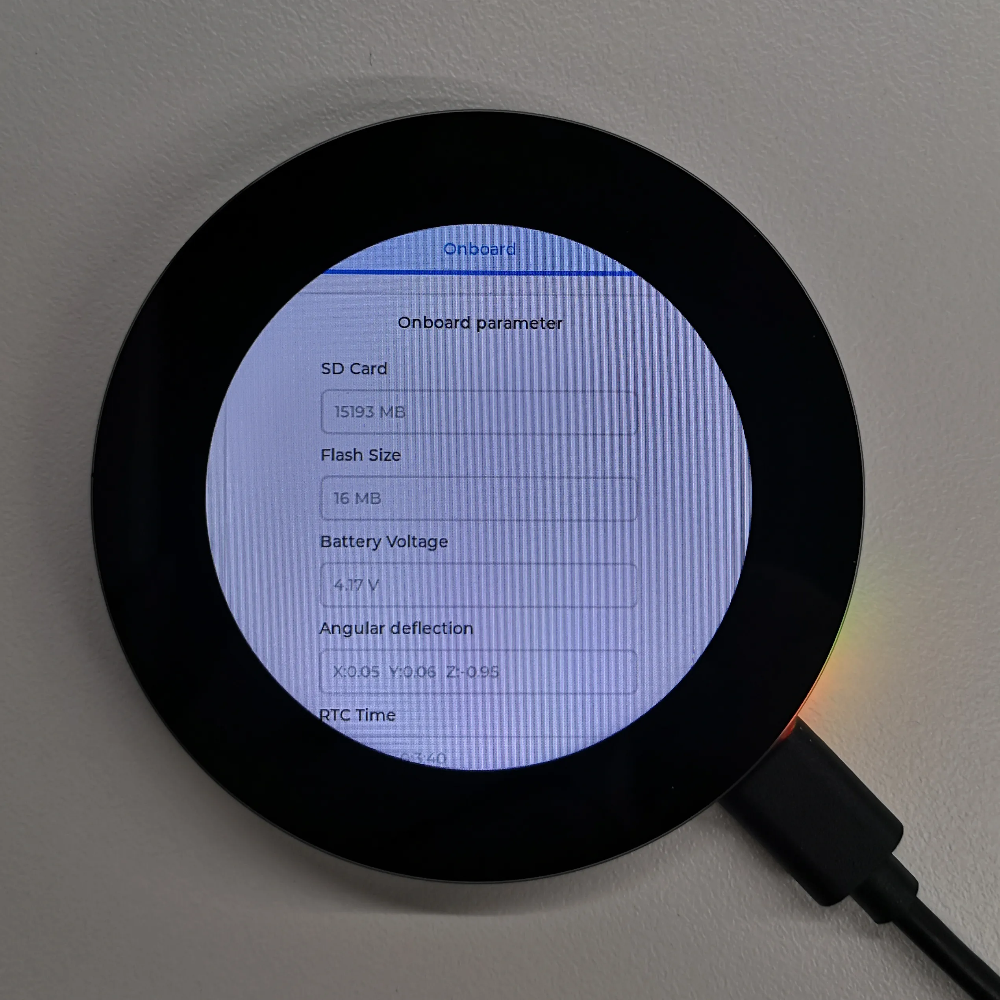

# 04 — Arduino Development

## Toolchain versions (pinned — do not drift)

| Component | Required version | Install method |
| --- | --- | --- |
| Board package | **`esp32-XIP-3.0.2`** | **Offline only** |
| LVGL | **8.3.10** | **Offline only** |

The vendor wiki is emphatic about this:

> "There are strong dependencies between versions of LVGL and its driver
> libraries. For example, a driver written for LVGL v8 may not be compatible with
> LVGL v9. To ensure that the examples can be reproduced reliably, it is
> recommended to use the specific versions listed in the table above. Mixing
> different versions of libraries may lead to compilation failures or runtime
> errors."

`examples/arduino/lvgl-library.properties` confirms `version=8.3.10`,
author `kisvegabor`, main LVGL repo.

> **LVGL 8 vs LVGL 9 is a real API break.** In v9 the input device, display and
> timer APIs all changed, and `lv_disp_draw_buf_t` / `lv_disp_drv_t` were
> restructured. The vendor's `LVGL_Driver.cpp` is v8. If you want LVGL 9 you must
> port the driver yourself. For a first firmware, stay on **8.3.10**.

## Setup

### 1. Arduino IDE

Follow the vendor's
[Installing and Configuring Arduino IDE](https://docs.waveshare.com/ESP32-Arduino-Tutorials/Arduino-IDE-Setup)
guide to install the IDE and add ESP32 support.

### 2. Libraries — offline

The Arduino Library Manager cannot supply the right LVGL. Install from the
vendor demo archive:

1. Download
   [`ESP32-S3-Touch-LCD-2.8C-Demo.zip`](https://files.waveshare.com/wiki/ESP32-S3-Touch-LCD-2.8C/ESP32-S3-Touch-LCD-2.8C-Demo.zip)
2. Copy every folder from its `Arduino/libraries` directory into your Arduino
   libraries folder
3. Locate that folder via **File → Preferences → Sketchbook location**; it is the
   `libraries` subfolder. On Windows it is typically
   `c:\Users\<username>\Documents\Arduino\libraries`

> The demo archive is 71 MB, of which the bundled LVGL is the bulk. We extracted
> only the sketch source into `examples/arduino/` — the LVGL tree itself is not
> committed here. You will need the archive to build.

### 3. Board package — offline

Install **`esp32-XIP-3.0.2`** per the vendor's
[board installation tutorial](https://www.waveshare.com/wiki/Esp32-XIP-3.1.1_Development_Board_Installation).
It is offline-only.

## The example

`Arduino/examples/LVGL_Arduino/LVGL_Arduino.ino` in the archive; mirrored at
`examples/arduino/LVGL_Arduino.ino`.

### Hardware connection

Per the wiki:

- Insert a TF card into the board
- Connect the board to the computer

### Structure

```cpp
void Driver_Init() {
  Flash_test();
  BAT_Init();
  I2C_Init();
  delay(120);                // ms
  TCA9554PWR_Init(0x00);     // expander FIRST — everything depends on it
  Set_EXIO(EXIO_PIN8, Low);  // buzzer off
  PCF85063_Init();
  QMI8658_Init();
}

void Driver_Loop(void *parameter) {   // separate task
  while (1) {
    QMI8658_Loop();
    RTC_Loop();
    BAT_Get_Volts();
    vTaskDelay(pdMS_TO_TICKS(100));
  }
}

void setup() {
  Wireless_Test2();
  Driver_Init();
  LCD_Init();   // line 37 — must precede SD_Init
  SD_Init();    // line 38 — must follow LCD_Init; redo if the LCD re-inits
  Lvgl_Init();
  ...
}
```

Note the expander is initialised **after** `I2C_Init` (it is an I2C device) but
**before** the LCD, touch or SD. This ordering is not optional.

## What the demo shows

A tabbed LVGL UI displaying live hardware state. The BOOT button navigates it:

| Gesture | Action |
| --- | --- |
| Single click | Next control option |
| Double click | Previous control option |
| Long press | Activate the selected option |

| Panel | Shows | Notes |
| --- | --- | --- |
| SD Card | TF card size | If not recognised, **format FAT32**. If first detection fails, wait and reset. |
| Flash Size | Flash size | 16 MB onboard |
| Battery Voltage | Battery voltage | Only readable with a battery connected |
| Angular deflection | Board orientation, 3 axes | From the QMI8658 |
| RTC Time | Current RTC time | **Will not persist without an RTC battery** |
| Wireless scan | Number of Wi-Fi networks found | Ends with "Scan Finish" |
| Buzzer test | Buzzer on/off | Via `EXIO_PIN8` |
| Backlight brightness | Brightness slider | PWM on GPIO6 |




## Arduino-specific notes

**The Arduino and ESP-IDF examples are not interchangeable.** Beyond the pin
defines, they differ in ways that matter:

| | Arduino | ESP-IDF |
| --- | --- | --- |
| LVGL | 8.3.10 | `~8.2.0` |
| Pixel clock | 30 MHz | 18 MHz |
| Frame buffers | 1 | 1 or 2 |
| LEDC channel for backlight | 1 | 0 |
| Tear avoidance | Bounce buffer | Semaphores |
| Expander pin names | `EXIO_PIN1`–`EXIO_PIN8` | `TCA9554_EXIO1`–`TCA9554_EXIO8` |
| I2C defines | `I2C_SCL_PIN` / `I2C_SDA_PIN` | `I2C_MASTER_SCL_IO` / `I2C_MASTER_SDA_IO` |
| Driver class | `Display_ST7701` | `ST7701S` |

Pick a framework and stick to it. Do not port code between them line by line
expecting it to work.

**Arduino LVGL setup has extra steps** beyond the vendor example. The sketch
header points at the official guide:

```cpp
/*Using LVGL with Arduino requires some extra steps:
 *Be sure to read the docs here: https://docs.lvgl.io/master/get-started/platforms/arduino.html */
```

The Arduino-ESP32 port requires a `lv_conf.h` and the `LVGL_LVGL_HOLDER` /
`LVGL_LVGL_PORT` options in the board menu — see the LVGL Arduino guide linked
above. This is the usual source of "LVGL compiles but the screen stays blank"
reports.

## LVGL tuning

`sdkconfig` equivalents aside, the Arduino example enables:

- Chart widgets
- Performance monitor
- User data

If you fork from the vendor example, these are already on. For a nav UI the
performance monitor (`lv_use_perf_monitor`) is genuinely useful — it is the
fastest way to see whether your map renderer is going to fit the frame budget.

## Other LVGL references

- LVGL documentation: <https://docs.lvgl.io/master/>
- Waveshare SquareLine Studio tutorial (referenced from the board FAQ):
  <https://www.waveshare.com/wiki/Waveshare_SquareLine_Studio>

> SquareLine Studio generates LVGL **v8 or v9** depending on the version you
> download. Pin the tool to v8 output to match `8.3.10`, or you will generate UI
> files that will not compile against the vendor driver.
