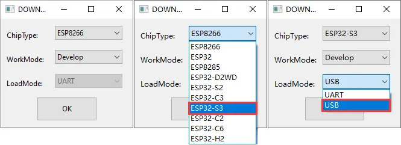
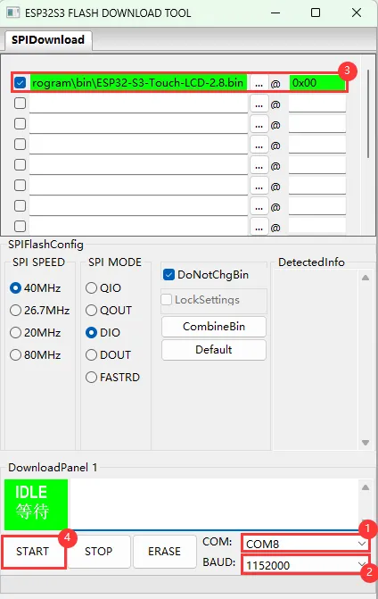
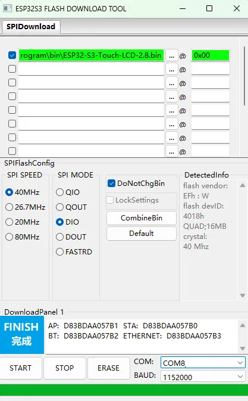
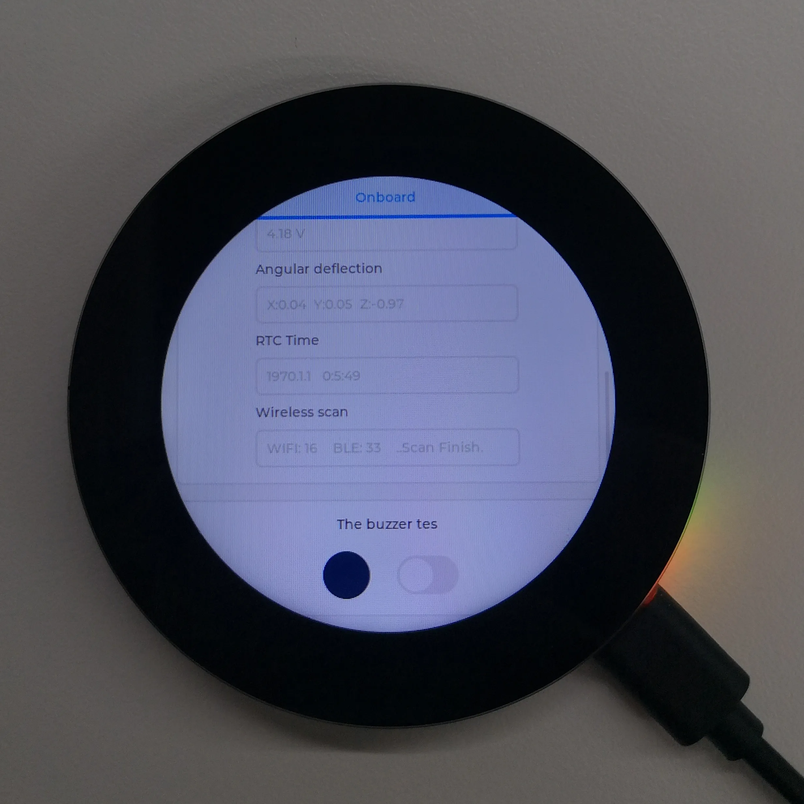

# 06 — Flashing and Erasing

Waveshare ships a prebuilt test firmware so you can verify every onboard device
before writing any code. **Do this first** — it is the fastest way to confirm the
board, display, touch, IMU, RTC, SD slot and battery are all healthy.

## The test firmware

| | |
| --- | --- |
| Source archive | [`ESP32-S3-Touch-LCD-2.8C-Demo.zip`](https://files.waveshare.com/wiki/ESP32-S3-Touch-LCD-2.8C/ESP32-S3-Touch-LCD-2.8C-Demo.zip) |
| Location in archive | `Firmware/ESP32-S3-Touch-LCD-2.8C.bin/` |
| **Flash address** | **`0x00`** |
| Size | 16,777,216 bytes — a full merged image |

Because it is a single merged binary at `0x00`, **it will overwrite the entire
flash including partition table and any data you have stored.** Treat it as a
factory reset.

> We did not commit the 16 MB binary into this repository. Download it from the
> archive above when you need it.

## Flashing

### 1. Get the tool

Download and extract Espressif's
[Flash Download Tool](https://dl.espressif.com/public/flash_download_tool.zip)
(Windows GUI; the vendor demo's ReadMe references **flash_download_tool_3.9.5**).

> The Flash Download Tool is Windows-only. On Linux/macOS use `idf.py flash` or
> `esptool.py` from ESP-IDF instead — the merge layout at `0x00` is the same.

### 2. Configure

Select options matching the board's MCU and download interface. The wiki's
screenshot uses **ESP32-S3 / USB**; use what your hardware needs.



| Setting | Value |
| --- | --- |
| COM port | Your board's serial port — see [finding it](#finding-the-com-port) |
| BAUD | **1152000** (maximum) |
| Chip | ESP32-S3 |
| File | `ESP32-S3-Touch-LCD-2.8C.bin` from the archive |
| Address | **`0x00`** |
| Row checkbox | **Must be ticked** |



> The checkbox matters. An unticked row is silently skipped and you will get a
> "success" that wrote nothing.

### 3. Flash

Click **START** and wait. This can take a while — be patient.

### 4. Verify

Press **RESET** and check the display.





## Erasing

The same tool, with `ESPTOOL` / erase-flash selected instead of writing a file.
This clears all flash contents.

Equivalent with `esptool`:

```bash
esptool.py --chip esp32s3 erase_flash
```

And with ESP-IDF:

```bash
idf.py erase-flash
```

> Erasing removes the partition table. Whatever you flash next must write its own
> partition table, or the board will not boot.

## If it will not enter download mode

The board has an **auto-download circuit** around the CH343P, so normally you just
press flash. When that fails:

> "If the tool remains at 'Waiting for power-on sync', hold down **BOOT** and
> power cycle the device to enter download mode."

Sequence:

1. **Completely power off** the board (unplug USB; if a battery is fitted, turn
   the battery switch off too)
2. Hold **BOOT**
3. Power on / plug USB
4. Release **BOOT**
5. Flash

> "After flashing, the module will not automatically exit download mode, so you
> need to power cycle again."

This is a full power cycle, not a reset press. A crashed firmware can hold the
ESP32-S3 in a state where the USB bridge cannot assert the reset line, which is
why `RESET` alone is not enough.

## Finding the COM port

From the vendor FAQ.

### Windows

1. **Device Manager** — `Win`+`R`, type `devmgmt.msc`, expand **Ports (COM & LPT)**
2. **Command Prompt** — run `mode` to list all COM ports and their status
3. **By hardware** — an attached device typically occupies a port; identify it by
   what you have plugged in

### Linux

1. `dmesg` — watch for the device connecting
2. `ls /dev/ttyS*` or `ls /dev/ttyUSB*` — list serial devices
3. `setserial -g /dev/ttyS*` — view configuration

```bash
# Practical approach on Linux
ls /dev/ttyACM* /dev/ttyUSB* 2>/dev/null
dmesg | tail -20
```

On macOS the device appears under `/dev/cu.*`:

```bash
ls /dev/cu.*
```

> **Two serial ports exist.** One is the CH343P USB-to-UART bridge, the other is
> the ESP32-S3's native USB (GPIO19/GPIO20). Either can flash. The native USB port
> is faster and works even if the CH343P is unhappy, but it enumerates as a
> different device class and can disappear if firmware reconfigures USB.
>
> Recall from [02-pinout.md](02-pinout.md): **the 4-pin UART header is cut when
> the USB-to-UART Type-C is plugged in.** If you are using the UART header for a
> GPS module, leave that cable unplugged during flashing.

## Permissions on Linux

```bash
# Identify the board
lsusb | grep -i serial
lsusb | grep -i 1a86      # QinHeng (CH343P vendor)

# Temporary access
sudo chmod 666 /dev/ttyUSB0

# Permanent: add yourself to the dialout group
sudo usermod -aG dialout $USER
# then log out and back in
```

If you are using the **native USB** port instead, the udev rules shipped with
ESP-IDF are usually required — see the
[Espressif udev rules](https://docs.espressif.com/projects/esp-idf/en/latest/esp32/api-guides/usb-serial-jtag-console.html).

## Recovery reference

| Symptom | Cause | Fix |
| --- | --- | --- |
| "Waiting for power-on sync" forever | Not in download mode | Full power cycle while holding BOOT |
| Flash fails, port busy | Serial monitor has the port open | Close the monitor, retry |
| Flash fails, program crashed | Chip not responding on reset | Full power off, hold BOOT, power on, flash, then power cycle again |
| No new COM port | Bad cable or wrong port | Try the other USB-C; use a data cable not a charge-only one |
| Flash succeeds, board dead | Merged binary without partition table | Erase and reflash, or write a full image |
| Blank screen after flashing | PSRAM not enabled, or backlight off | Check `CONFIG_SPIRAM_*` and GPIO6 PWM |
