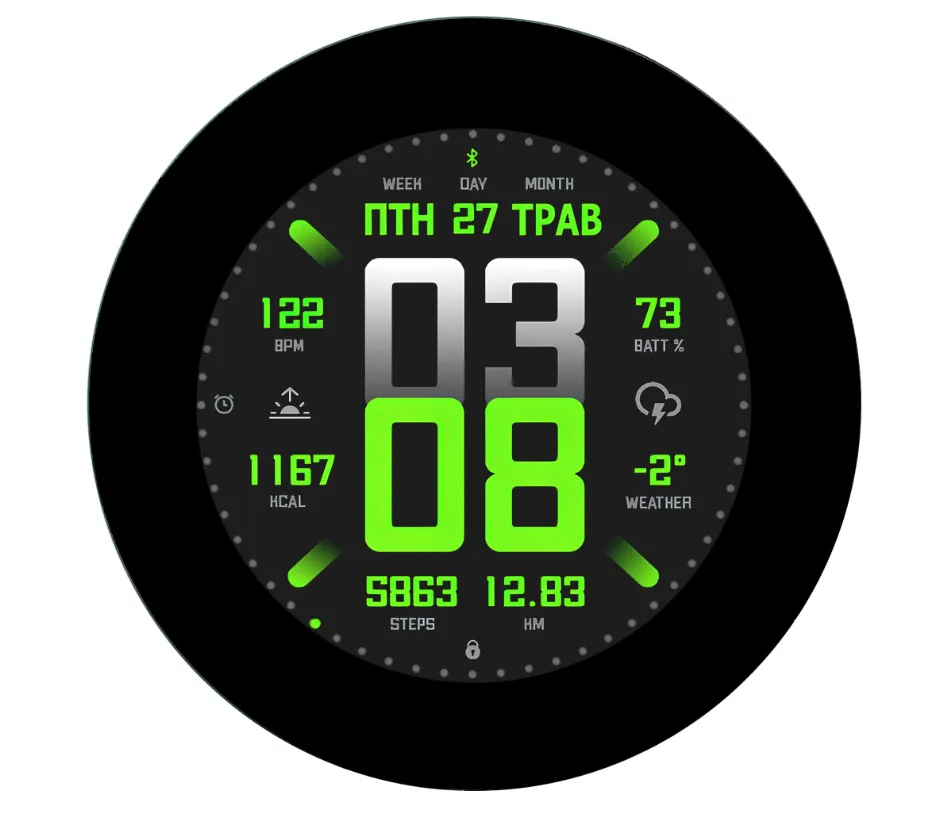

# Waveshare ESP32-S3-Touch-LCD-2.8C

Microcontroller development board with an onboard 2.8" round capacitive touch
display. Wi-Fi + BLE, 8 MB PSRAM, 16 MB Flash. Suitable for HMI and — the point
of this project — for a navigation device.

| | |
| --- | --- |
| **Board** | ESP32-S3-Touch-LCD-2.8C |
| **SKU** | 29086 |
| **SoC** | ESP32-S3R8 — Xtensa LX7 dual-core @ 240 MHz |
| **Display** | 2.8" 480 × 480, capacitive, ST7701S RGB565 driver IC |
| **Touch** | GT911 capacitive, I2C + interrupt |
| **IMU** | QMI8658 6-axis (3-axis gyro + 3-axis accelerometer) |
| **RTC** | PCF85063, with backup battery header |
| **Memory** | 512 KB SRAM, 384 KB ROM, 8 MB PSRAM (octal, 80 MHz), 16 MB Flash |
| **Wireless** | Wi-Fi 802.11 b/g/n 2.4 GHz, Bluetooth 5 LE, onboard antenna |
| **Storage** | TF/microSD card slot (1-bit SD/MMC) |
| **Power** | USB-C, 3.7 V LiPo via MX1.25 2-pin header, ME6217C33M5G LDO 800 mA |
| **Extras** | Buzzer, battery charging management, GPIO expander, auto-download circuit |
| **Price class** | $32.99 – $39.99 USD |
| **Variants** | Sold as "With Touch Function" / "Without Touch Function" — confirm which you have |
| **Form factor** | **Round**, 95.86 mm diameter module, 4 × ΦM2 mounting holes |
| **Buy** | <https://www.waveshare.com/esp32-s3-touch-lcd-2.8c.htm?sku=29086> |
| **Wiki** | <https://docs.waveshare.com/ESP32-S3-Touch-LCD-2.8C> |

## TL;DR — what matters for firmware

- **Display is RGB565 parallel**, not SPI. It eats 16 GPIO for pixel data plus
  PCLK/HSYNC/VSYNC/DE. A real SPI peripheral still exists (GPIO1/GPIO2) but is
  used only to send the ST7701S init sequence.
- **One shared I2C bus** at 400 kHz on GPIO7/GPIO15 carries touch, IMU, RTC and
  the GPIO expander. Fixed pins, not remappable.
- **The GPIO expander (TCA9554PWR) is the important gotcha.** LCD chip-select,
  LCD reset, touch reset, SD card chip-select and the buzzer all sit behind it.
  A GPIO you cannot see in the pinout controls your display.
- **GPIO1 and GPIO2 are shared** between the LCD's SPI port and the TF card's
  SD/MMC port. The vendor code relies on init ordering to cope; be careful.
- **Only 65K colours** (RGB565), despite the panel supporting 262K. See FAQ.
- **LVGL 8.x, not 9.x.** Arduino examples pin LVGL 8.3.10; the IDF manifest
  requests `~8.2.0`. Mixing with LVGL 9 breaks the drivers.

## Documentation map

| Doc | Purpose |
| --- | --- |
| [01-hardware-overview.md](01-hardware-overview.md) | Every chip and connector on the board, with notes |
| [02-pinout.md](02-pinout.md) | **Complete GPIO map** — read this first |
| [03-display-touch-sensors.md](03-display-touch-sensors.md) | Panel timings, touch config, IMU, RTC, battery, SD |
| [04-development-arduino.md](04-development-arduino.md) | Arduino toolchain and library versions |
| [05-development-esp-idf.md](05-development-esp-idf.md) | ESP-IDF toolchain, sdkconfig, partition table |
| [06-flashing.md](06-flashing.md) | Test firmware and how to recover a bricked board |
| [07-faq-troubleshooting.md](07-faq-troubleshooting.md) | Vendor FAQ plus hard-won gotchas |
| [08-resources-links.md](08-resources-links.md) | Datasheets, tools, tutorials, community projects |
| [09-hardware-notes-for-nav.md](09-hardware-notes-for-nav.md) | What this hardware means for a nav device |
| [10-map-tiles-reference.md](10-map-tiles-reference.md) | `0015/map_tiles` — SD-card map rendering, and the three things that bite |

## Two important caveats

**1. The board has no GPS.** There is no GNSS receiver on it. A navigation device
needs an external GPS module over UART (the 12-pin header breaks out
GPIO43/GPIO44 for exactly this) or over the TF/USB path. Plan for this.

**2. Waveshare does not support firmware customisation.** The FAQ states plainly
that the board is sold as a development board, not a finished product, and that
they do not assist with modifying code. Every line of nav firmware will be ours
to maintain. Budget for that.

## Licensing of bundled material

The datasheets, schematic and demo sources are Waveshare/Espressif/TI documents,
redistributed here for reference. Verify redistribution terms before publishing
this repository. The demo sources carry their original upstream licences —
see the SPDX headers in `examples/esp-idf/`.
